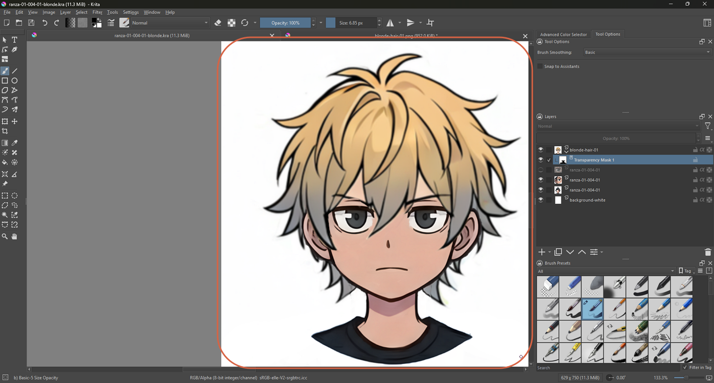
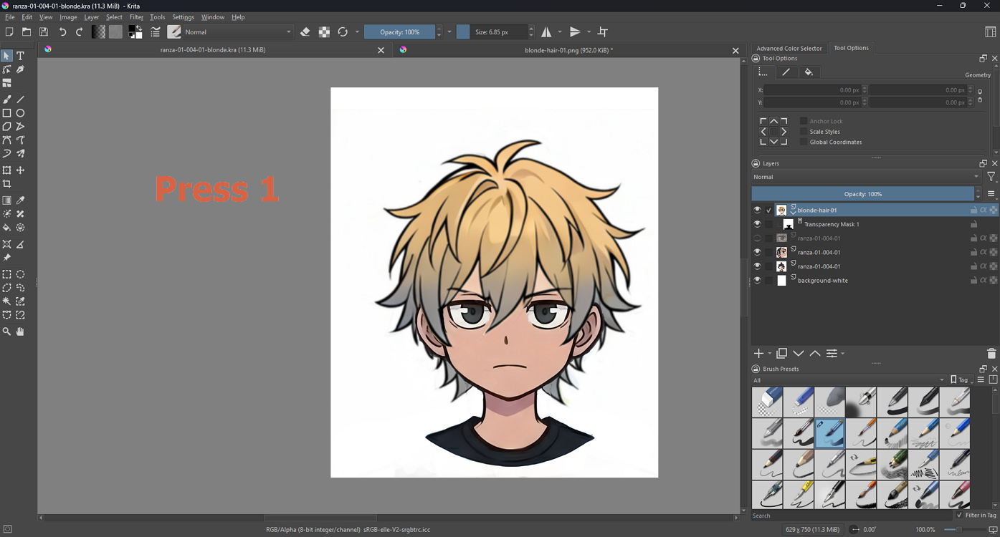
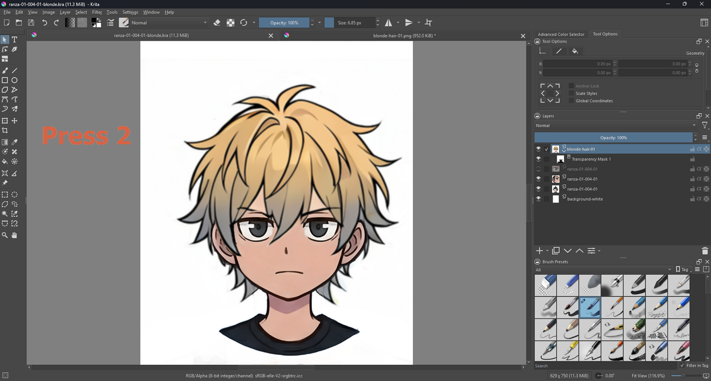
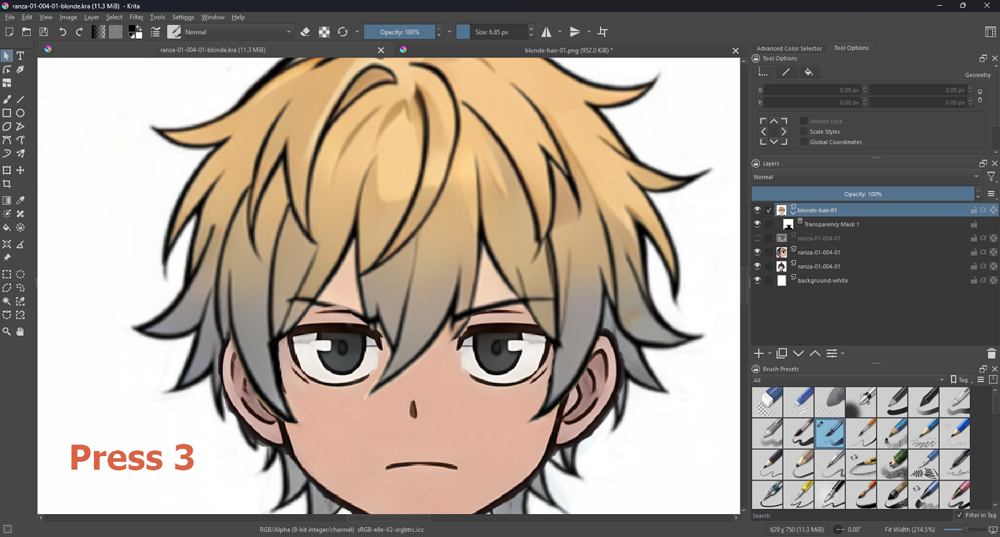
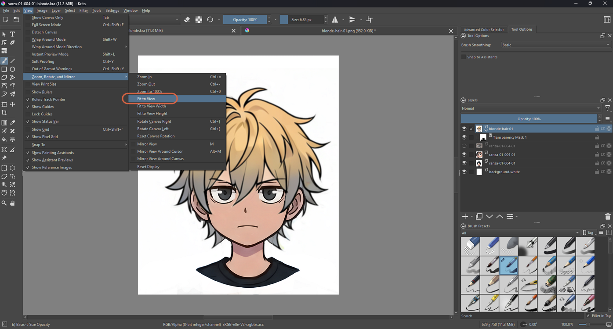
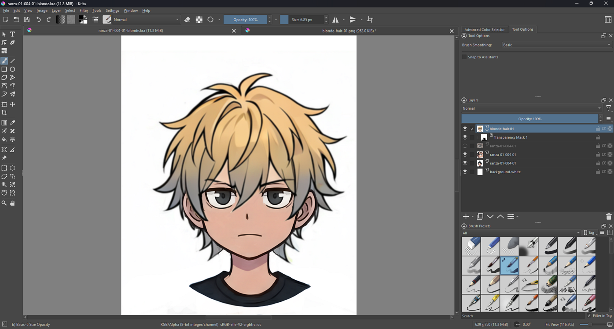

# Centering the Canvas with Fit to View

> **Note:** This document was generated by Claude Code and has not been reviewed by a human. Please use it as a reference only.

When the image sits off to one side or is bigger than the window, **Fit to View** zooms it to fit and centers it in one step.

> **Note:** Written using Krita 5.3.4.1 on Windows 11.

## The Problem

At a zoom level like 133.3%, a canvas can end up bigger than the visible area, so it's scrolled over to one side with empty grey space on the other. Zooming out isn't enough on its own — there's nothing to center until the zoom level actually changes to fit the window.

## Fix It with a Key

Three number keys change the zoom:

| Key | Status Bar Shows | What Happens |
|---|---|---|
| `1` | 100.0% | Actual size. |
| `2` | Fit View (116.9%) | The whole image fits in the window and sits in the center. |
| `3` | Fit Width (214.5%) | The image fills the window width; the top and bottom are cut off. |

## Step 1: Press 2

To center the whole canvas, press `2`. The status bar changes from `133.3%` to `Fit View (116.9%)`.

> **Note:** These three keys aren't listed in the View menu — this is what testing showed, not something documented in Krita's manual.

## Fix It from the Menu

## Step 2: Open the Fit to View Command

Choose **View** → **Zoom, Rotate, and Mirror** → **Fit to View**. The menu shows no shortcut next to it.

## Step 3: Check the Result

The whole canvas is centered and the status bar shows `Fit View (116.9%)`. The image's actual size is unchanged — only the view zoom changed.

Other items in the same submenu, with the shortcuts the menu shows:

| Command | Shortcut Shown |
|---|---|
| Zoom In | `Ctrl+=` |
| Zoom Out | `Ctrl+-` |
| Zoom to 100% | `Ctrl+0` |
| Fit to View | none shown |
| Fit to View Width | none shown |
| Fit to View Height | none shown |

## References

- [Krita Manual: View Menu](https://docs.krita.org/en/reference_manual/main_menu/view_menu.html) — doesn't list the zoom and fit commands; the key and menu details above come from testing.
- [Krita Artists Forum: Fit to Page](https://krita-artists.org/t/fit-to-page/25825) — a user mentions the Fit to View command in Krita 5.3.1.
