# Changing Hair Color

> **Note:** This document was generated by Claude Code and has not been reviewed by a human. Please use it as a reference only.

Three ways to recolor hair on its own layer: an HSV adjustment, a paint layer in Color blending mode, and a filter mask — plus how to match one exact color.

> **Note:** Written using Krita 5.3.4.1 on Windows 11.

## Starting Point

With the `blonde-hair-01` layer selected (the layer created in [Replacing Hair with Layers](replace-hair-with-layers.md)), the goal is to turn the blonde hair blue, and later match a specific color, `#384e74`.

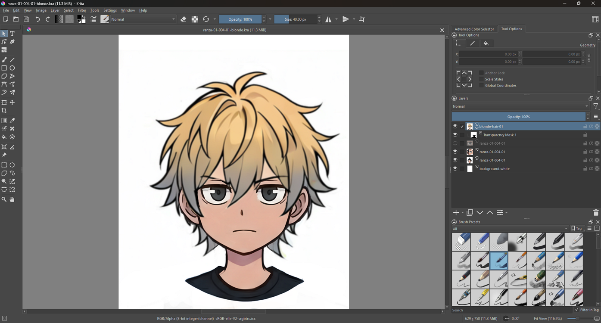

| Way | Changes the Pixels? | Good For |
|---|---|---|
| A. HSV/HSL Adjustment with Colorize | Yes, directly on the layer | The quickest way to a solid color. |
| B. Paint layer in Color blending mode | No, a new layer on top | Painting the color by hand, any exact color. |
| C. HSV/HSL filter mask | No, a mask on the layer | Changing the color later without touching the hair. |

## Method 1: HSV/HSL Adjustment

Select the layer, then choose **Filter** → **Adjust** → **HSV Adjustment…** (`Ctrl+U`).

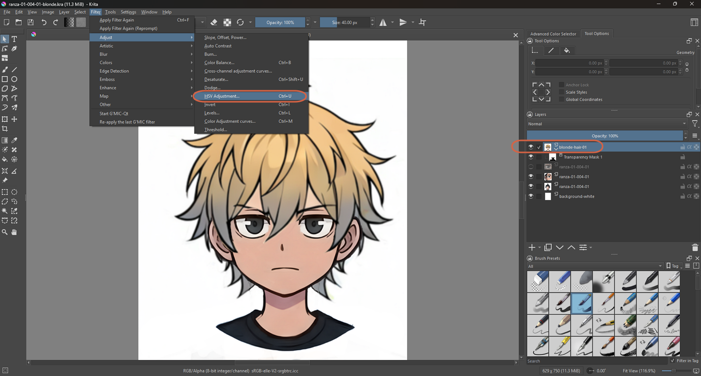

In the dialog, tick **Colorize** and set **Hue 215**, **Saturation 50**, **Lightness 0**. With Colorize on, the whole layer is tinted one color.

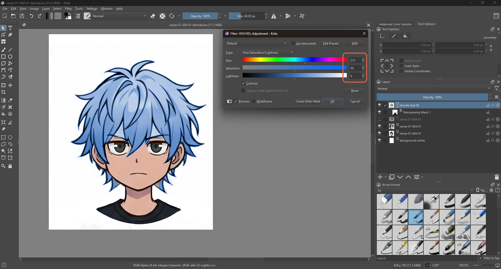

> **Note:** The filter is described on the Krita manual's Adjust filters page. Colorize is the option that sets one color for the whole layer instead of shifting the existing colors.

## Method 2: Paint Layer in Color Blending Mode

This way keeps the hair pixels untouched. A new layer on top holds the color, and its blending mode makes it tint what's underneath.

### Step 1: Add a Paint Layer

**Layer** → **New** → **Add Paint Layer** (`Ins`).

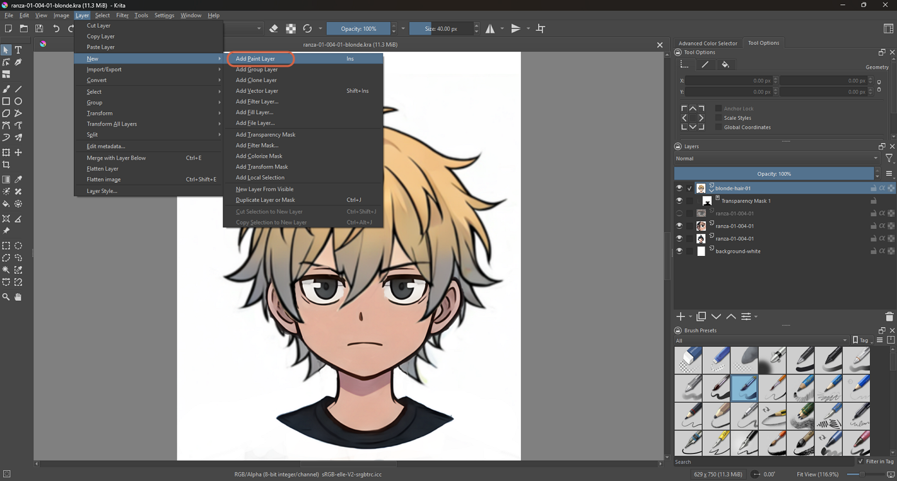

### Step 2: Set the Blending Mode to Color

Open the layer's **Properties** (`F3`), open the **Blending mode** list, and pick **Color**.

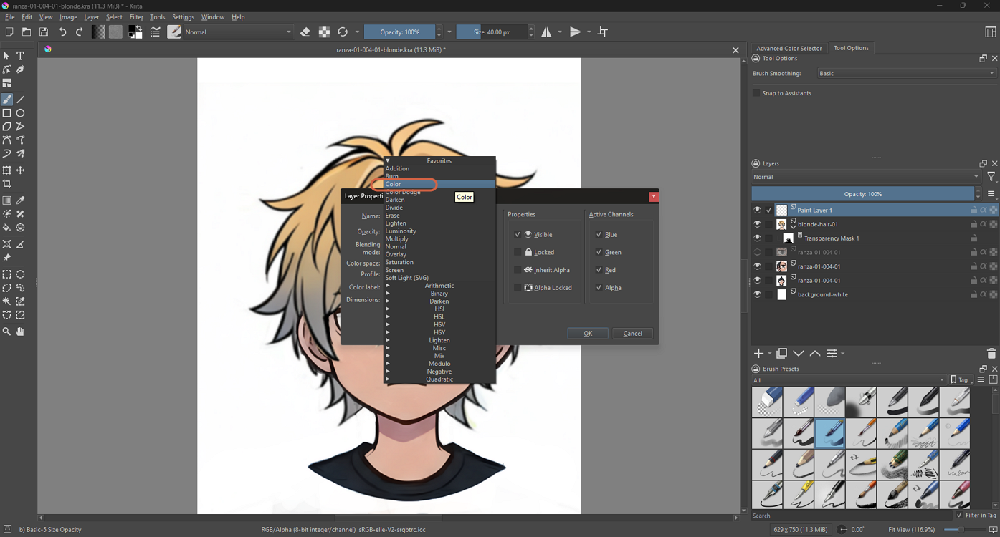

### Step 3: Pick a Color and Paint

Open the foreground color dialog, choose a color (pure blue, `#0000ff`, in this example), and paint over the hair with a brush.

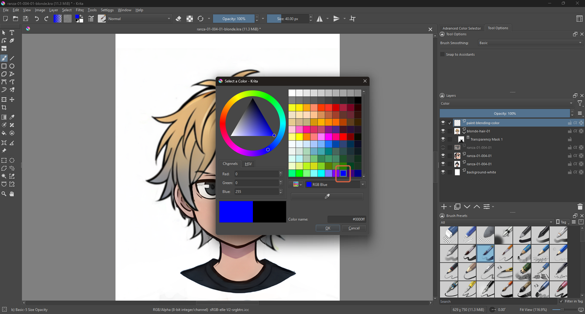

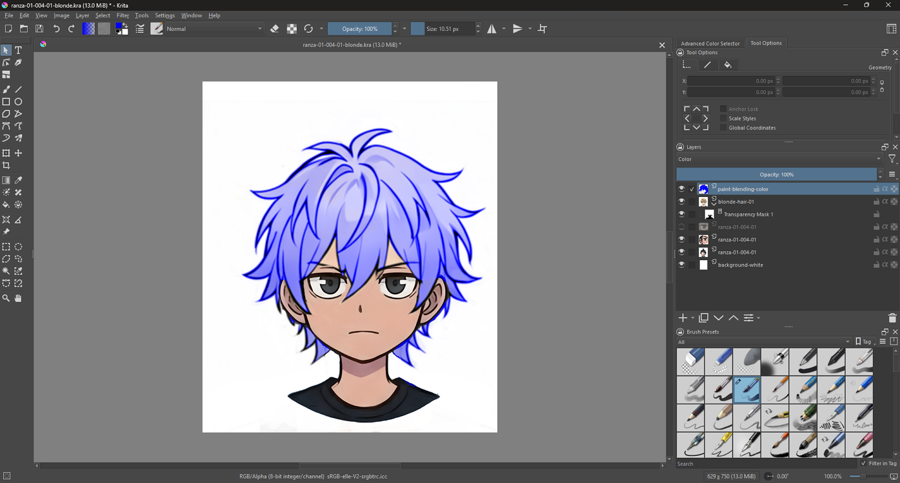

> **Note:** The Color blending mode takes the hue and saturation of the top layer and keeps the lightness of the layers below. See the manual page for the HSX blending modes.

## Method 3: HSV/HSL Filter Mask

A filter mask applies a filter to one layer without changing its pixels. Select the hair layer, then **Layer** → **New** → **Add Filter Mask…**, choose **HSV/HSL Adjustment**, and set the Hue.

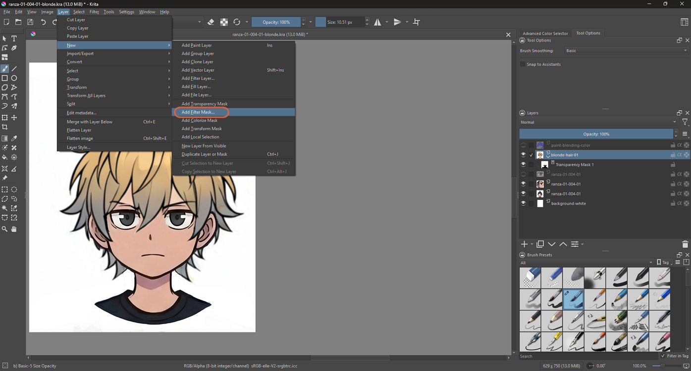

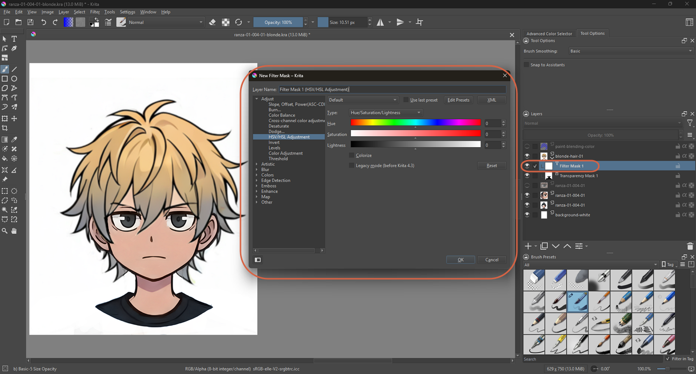

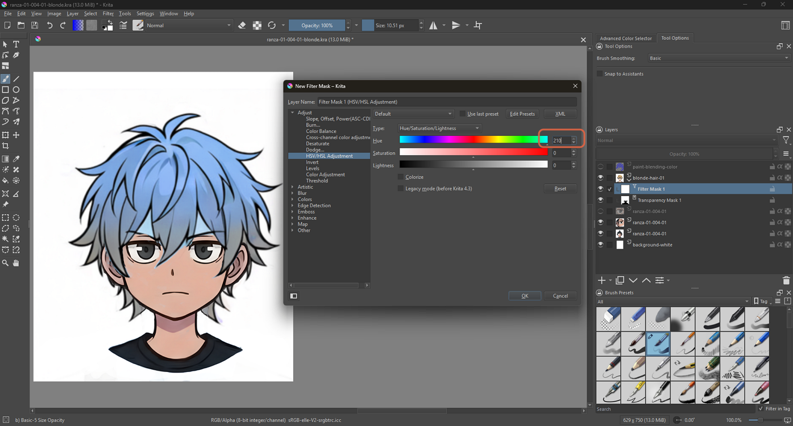

The mask shows up as a child of the layer in the Layers panel, and it can be switched off or deleted to get the original hair color back.

## Getting an Exact Color

To match a specific color from another picture, open it in the Windows Photos app and use its **Color Picker**. It shows the HEX, RGB, and HSL values.

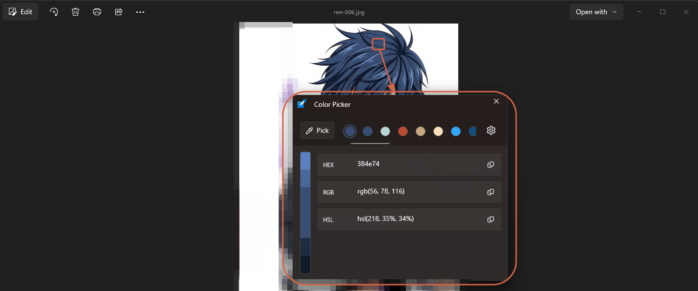

In Krita, go to the paint layer in Color mode (Method 2), open the foreground color dialog, and type the hex value into the **Color name** field. Paint again with that color.

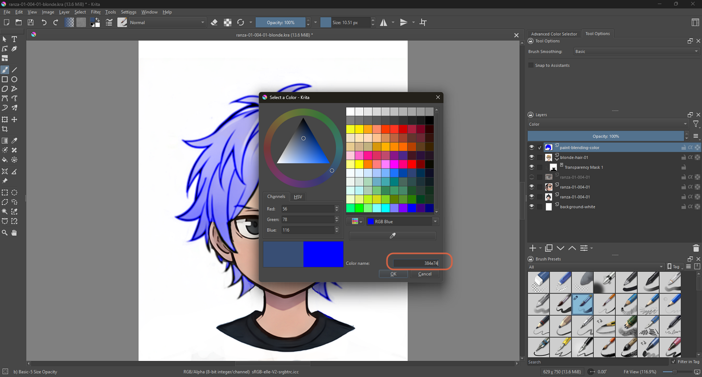

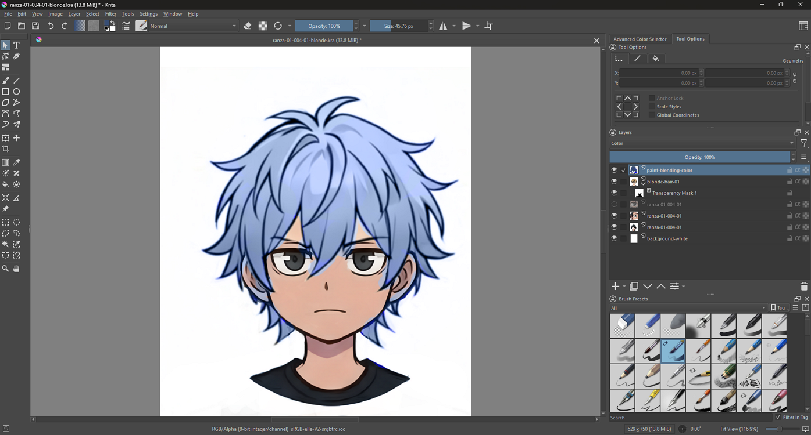

> **Warning:** Color mode keeps the lightness of the layer below, so the painted result can look lighter than the color you picked — the hair underneath was light, so the on-screen color isn't the same as the color you chose.

## Making It Darker

To bring the hair closer to the target, select the hair layer, open **Filter** → **Adjust** → **HSV Adjustment…** again, and set **Lightness** lower (Colorize off this time).

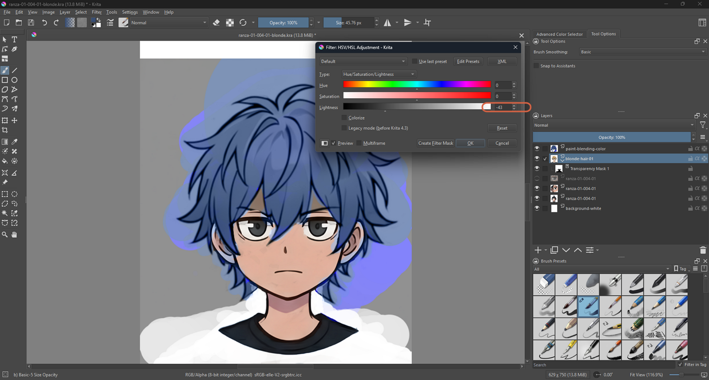

> **Note:** Lowering the lightness can make painted color spill outside the hair show up more clearly as patches on the background — clean those up next.

## Cleaning Up the Paint

Select the Freehand Brush, switch on **eraser mode** (the eraser button in the toolbar), and rub off any extra color that landed outside the hair on the paint layer.

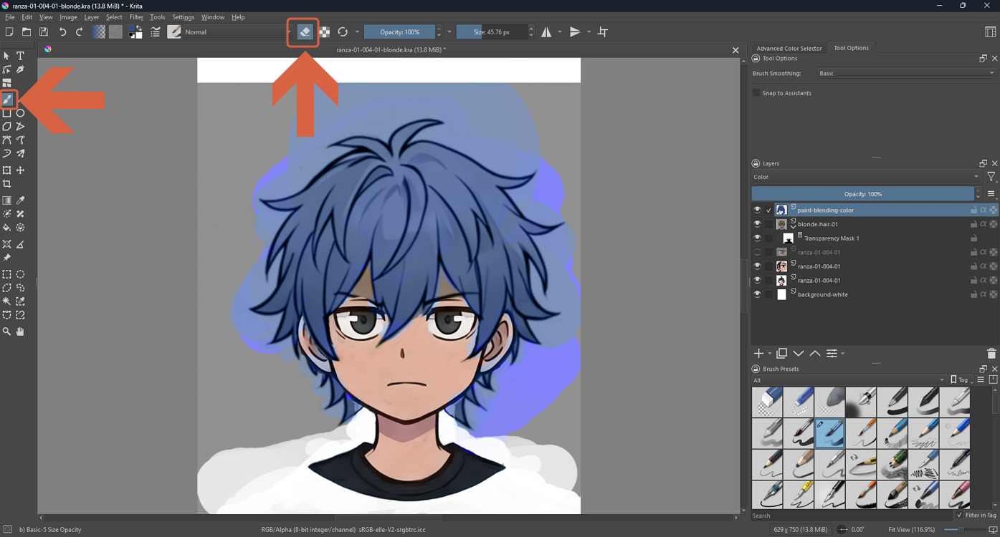

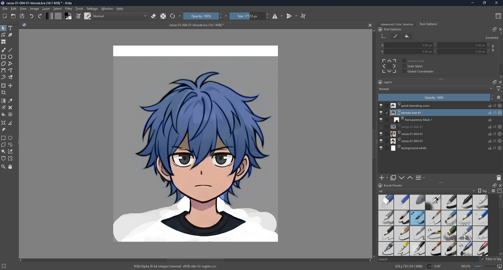

## References

- [Krita Manual: Adjust Filters](https://docs.krita.org/en/reference_manual/filters/adjust.html) — HSV/HSL Adjustment.
- [Krita Manual: HSX Blending Modes](https://docs.krita.org/en/reference_manual/blending_modes/hsx.html) — Color mode.
- [Krita Manual: Filter Masks](https://docs.krita.org/en/reference_manual/layers_and_masks/filter_masks.html)
