# Closing the Hair Line with a Curve

> **Note:** This document was generated by Claude Code and has not been reviewed by a human. Please use it as a reference only.

Blur an edge, then draw a black Bezier curve on a vector layer to close a gap in a hair outline, and merge it down. This follows on from [Cutting Out Hair](cut-out-hair.md), where a gap can be left under the fringe once the lines no longer join.

> **Note:** Written using Krita 5.3.4.1 on Windows 11.

## Starting Point

After a cut-out, the hair can have an open gap where the outline no longer joins — for example, under the fringe.

The rough flow: select the edge → Gaussian Blur → sample the outline color → draw a curve on a vector layer → merge down.

## Step 1: Select the Edge Area

Select the edge area with the Bezier Curve Selection tool (click points, then close the shape).

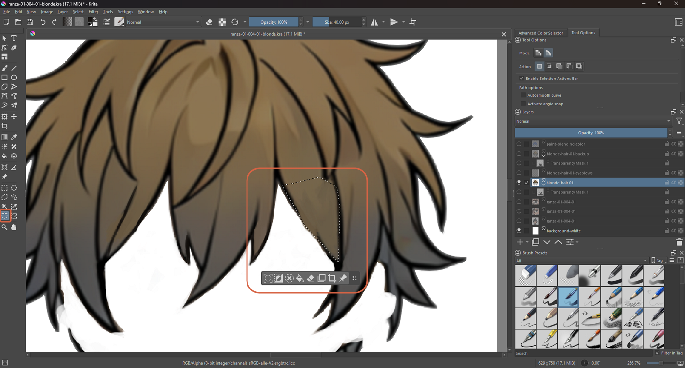

## Step 2: Blur the Edge with Gaussian Blur

Choose **Filter** → **Blur** → **Gaussian Blur…**.

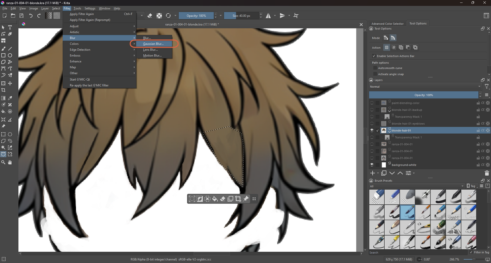

Raise the radius until the edge looks soft — the horizontal and vertical radius are linked, so they move together.

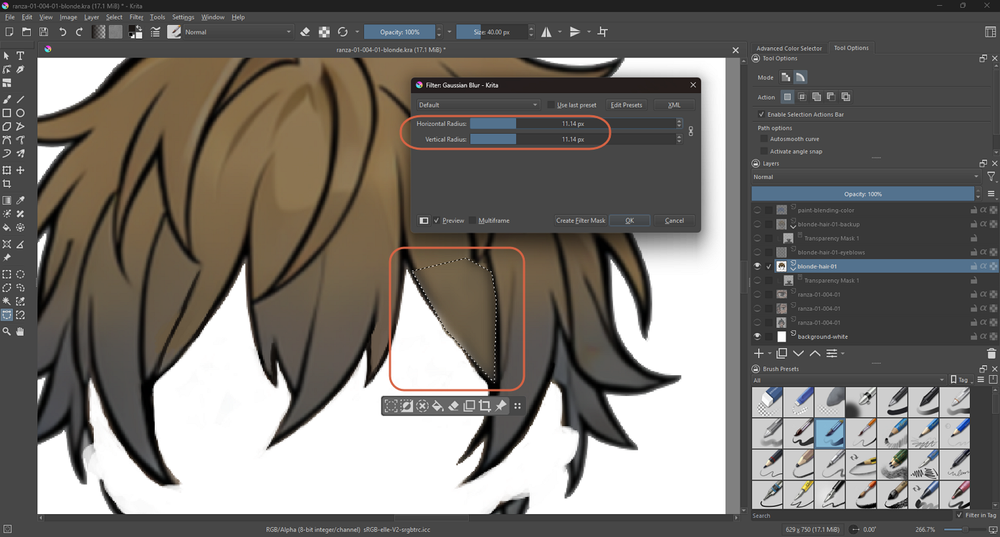

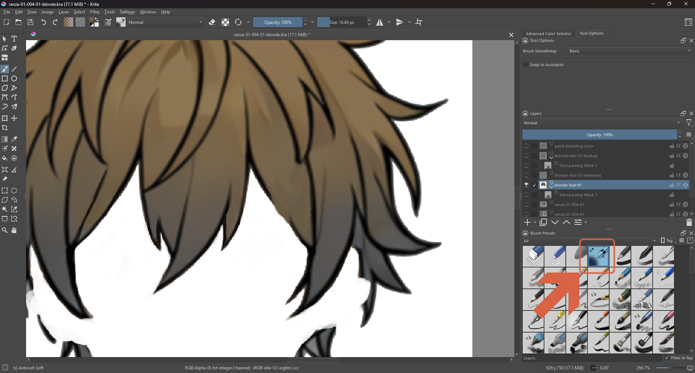

> **Note:** Gaussian Blur is on the Blur filters page of the Krita manual. A bigger radius gives a softer result.

## Step 3: Add a Paint Layer

**Layer** → **New** → **Add Paint Layer**.

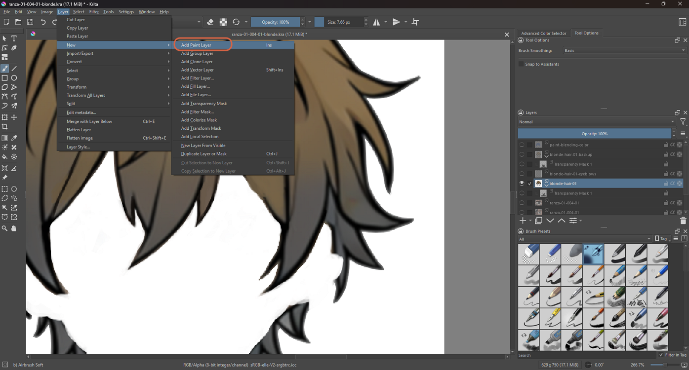

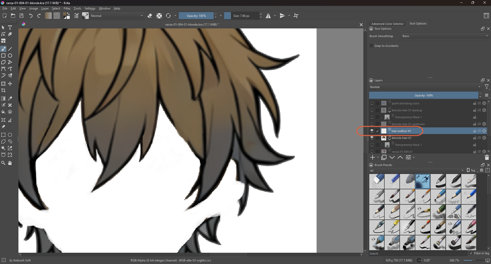

## Step 4: Sample the Outline Color

Choose the Airbrush Soft brush and the **Color Sampler** tool (set to *Sample All Visible Layers*, radius 1 px) to pick up the black of the existing outline.

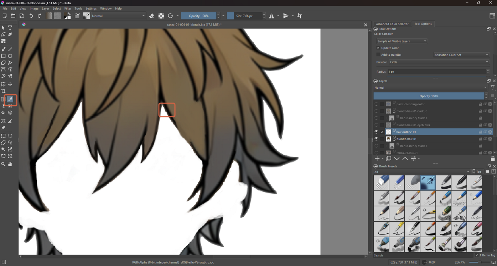

> **Note:** Right-clicking on the canvas opens a pop-up palette, which also lets you switch brushes.

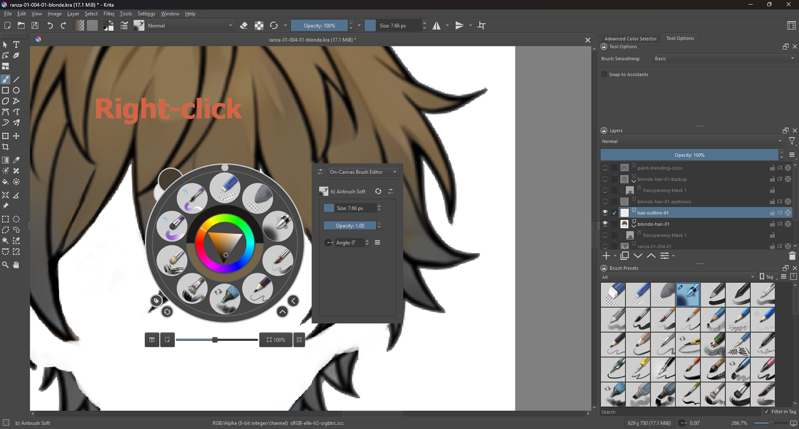

## Step 5: Add a Vector Layer

A vector layer keeps shapes as curves that can be edited later, so a wrong line is easy to fix. **Layer** → **New** → **Add Vector Layer** (`Shift+Ins`).

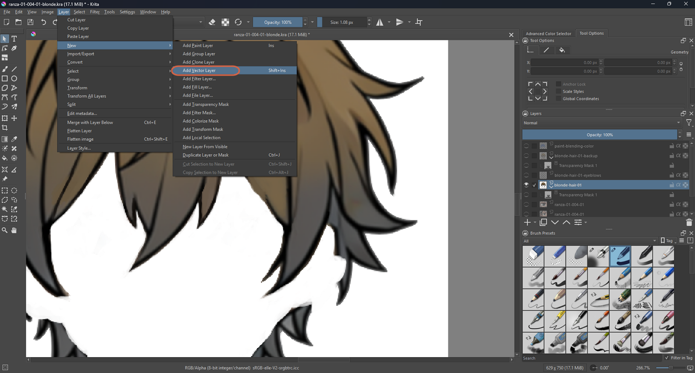

## Step 6: Choose the Bezier Curve Tool

In the toolbox, pick the **Bezier Curve Tool**. Its tooltip explains: Shift-click or double-click ends the curve. In the tool options, set **Fill: Not Filled** and **Outline: Brush**, with the Basic-1 brush.

## Step 7: Draw the Curve

Click where the line starts, then click and drag where it should bend. Press `Enter` or double-click to finish. The line is drawn with the current color — the sampled outline black.

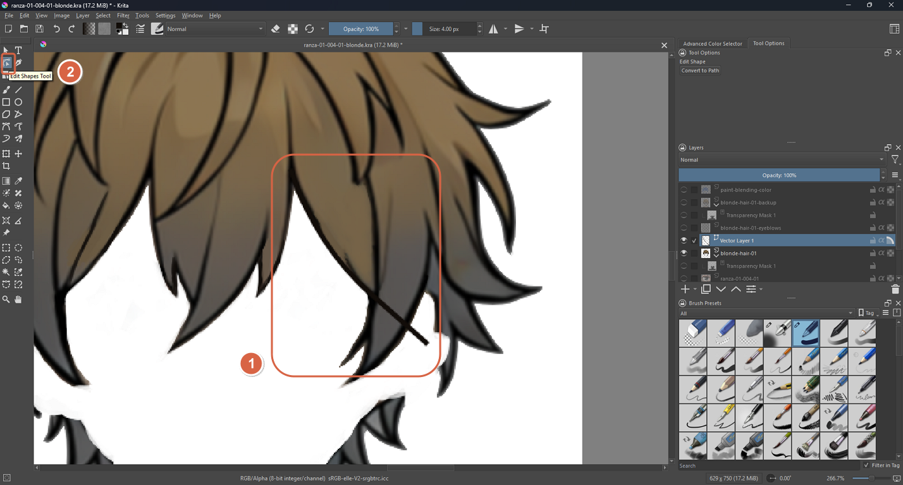

## Step 8: Adjust It with the Edit Shapes Tool

With the **Edit Shapes Tool**, the curve shows its nodes and handles. Dragging a node or a handle reshapes the line.

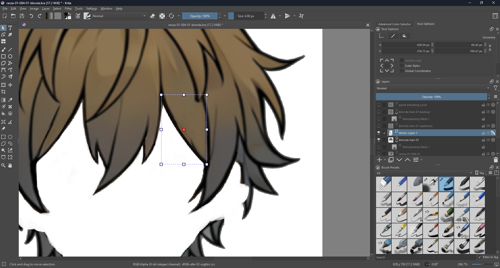

> **Note:** The Bezier Curve tool and the Edit Shapes tool both have pages in the Krita manual, including the Fill and Outline tool options shown above.

## Step 9: Merge It into the Hair Layer

With the vector layer selected, use **Merge with Layer Below** (`Ctrl+E`) — also available in the layer's right-click menu. When Krita asks how to merge the layer metadata, leave the strategy on **Smart**.

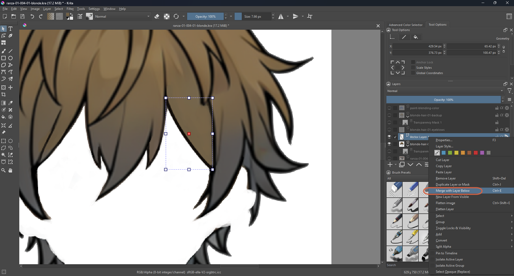

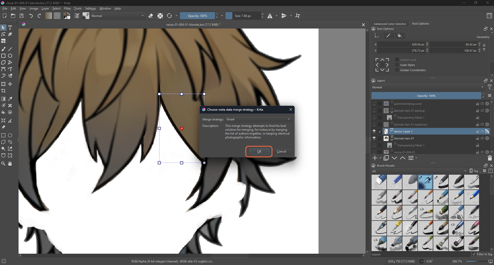

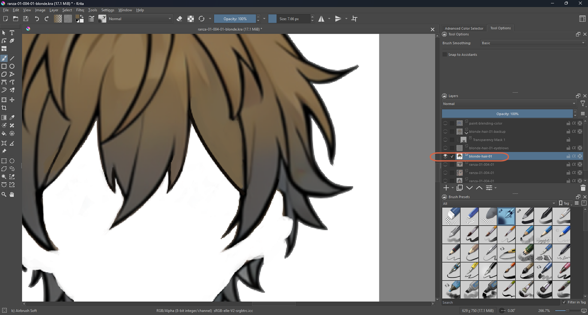

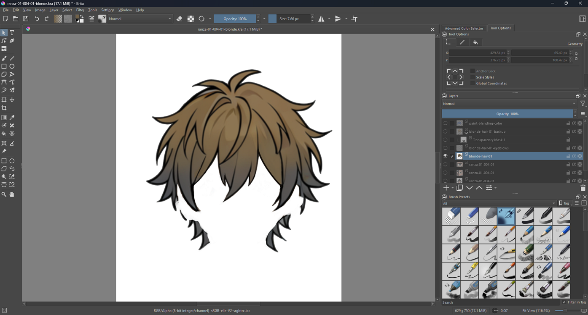

> **Warning:** After the merge, the hair layer may no longer show its Transparency Mask child in the Layers panel the way it did before — check whether the mask is still applied as expected.

## References

- [Krita Manual: Blur Filters](https://docs.krita.org/en/reference_manual/filters/blur.html) — Gaussian Blur.
- [Krita Manual: Bezier Curve Tool](https://docs.krita.org/en/reference_manual/tools/path.html)
- [Krita Manual: Edit Shapes Tool](https://docs.krita.org/en/reference_manual/tools/shape_edit.html)
- [Krita Manual: Freehand Brush Tool](https://docs.krita.org/en/reference_manual/tools/freehand_brush.html)
