# Cutting Out Hair

> **Note:** This document was generated by Claude Code and has not been reviewed by a human. Please use it as a reference only.

Remove the face and background from a hair layer with the magic wand, then tidy the edges with the eraser. The result doesn't need to be perfect.

> **Note:** Written using Krita 5.3.4.1 on Windows 11.

## Starting Point

The hair layer still has a grey background and part of the forehead around the hair. The goal is to get only the hair on its own layer.

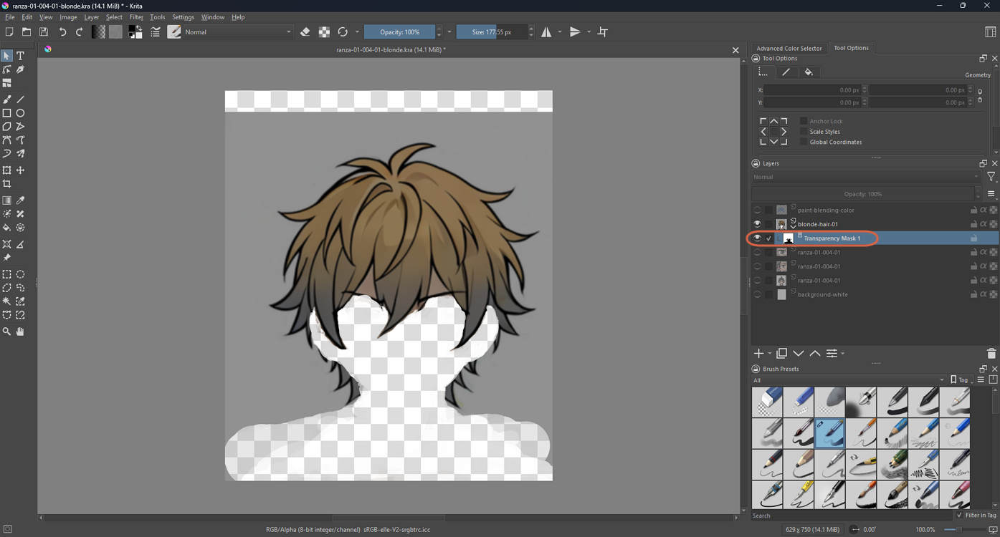

The rough flow: duplicate as a backup → select with the magic wand → delete → erase stray patches → separate the eyebrows onto their own layer.

## Step 1: Keep a Backup First

Before deleting anything, duplicate the layer: right-click the layer → **Duplicate Layer or Mask** (`Ctrl+J`). Rename the copy (for example, with a `-backup` suffix) and hide it, so you can always go back.

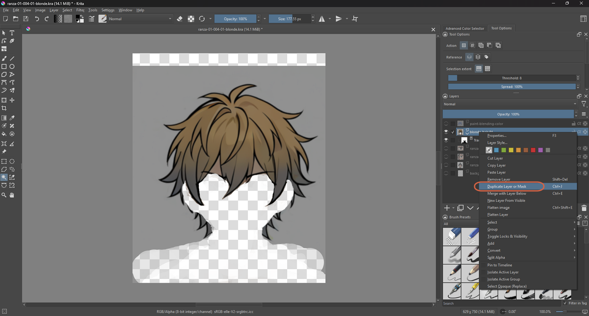

## Step 2: Select the Unwanted Area with the Magic Wand

In Krita, the magic wand is the **Contiguous Selection Tool**. It selects touching pixels that are close in color. In its tool options, use **Threshold 8**, **Spread 100%**, with Reference set to the current layer.

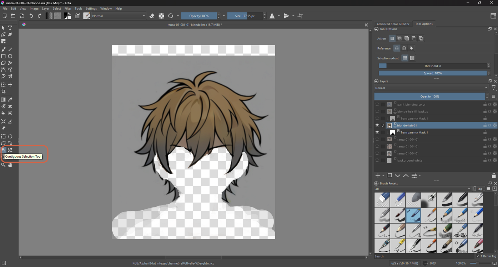

Click the area that isn't hair. The dotted outline (marching ants) shows what's selected.

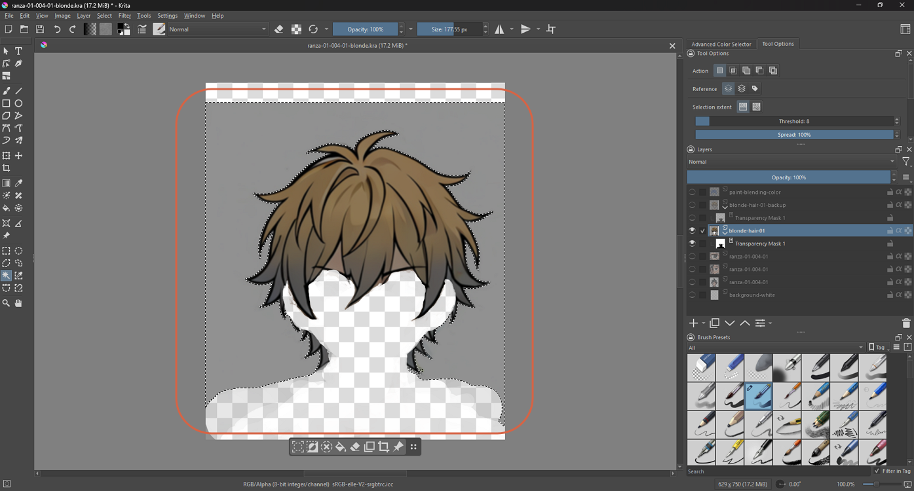

> **Note:** Threshold sets how different a pixel can be and still get selected. Spread softens the edge. Both are explained on the manual pages for the Contiguous and Similar selection tools.

## Step 3: Delete It

With the selection active and the correct layer selected, press `Del`. The area becomes transparent (the grey and white checkerboard). Then **Select** → **Deselect** (`Ctrl+Shift+A`).

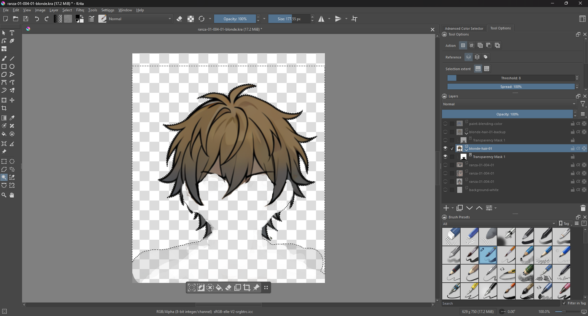

## Step 4: Rub Off Stray Patches

Some patches are usually left behind. Take the Freehand Brush, switch on **eraser mode**, and erase them — zoom in to reach small ones under the bangs.

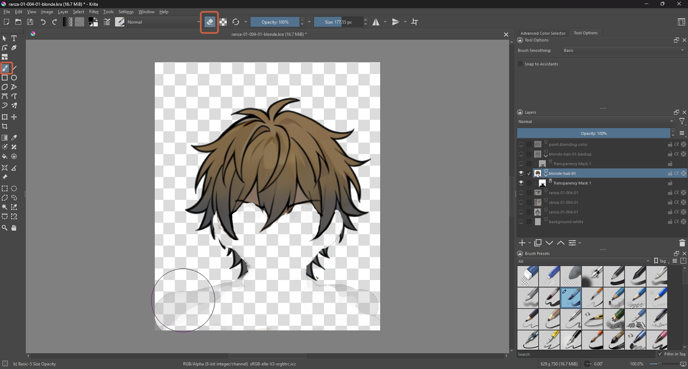

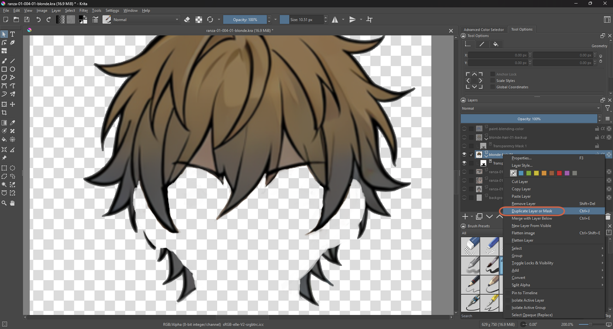

## Step 5: Separate the Eyebrows

If the eyebrows were part of the same picture as the face, they get removed along with it. Make a separate layer for them, so they can be turned on and off independently of the hair.

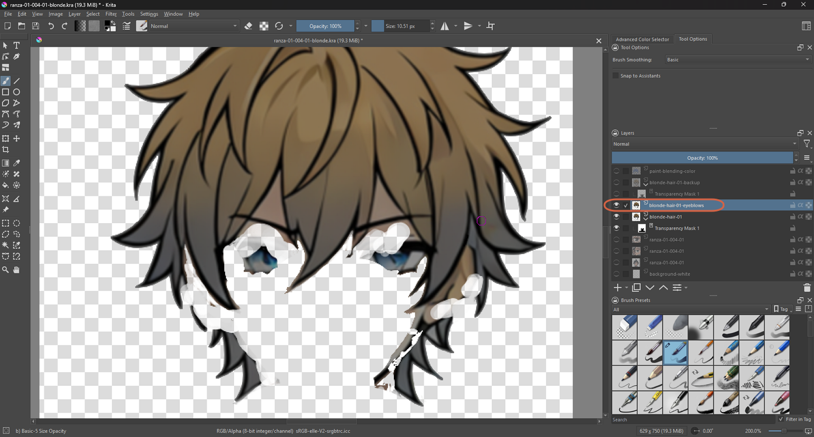

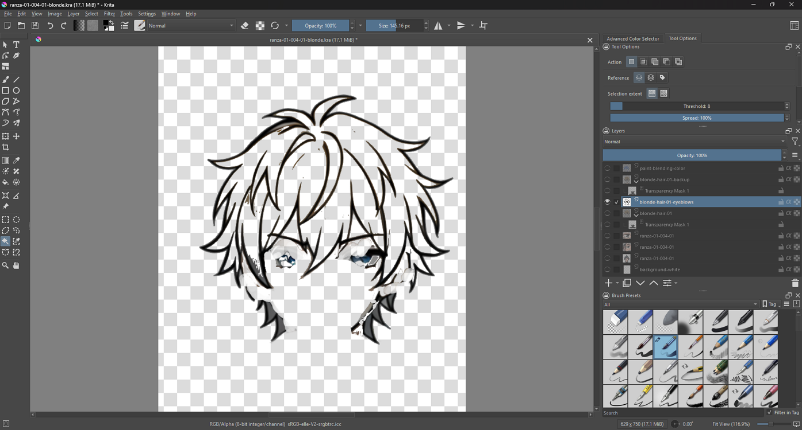

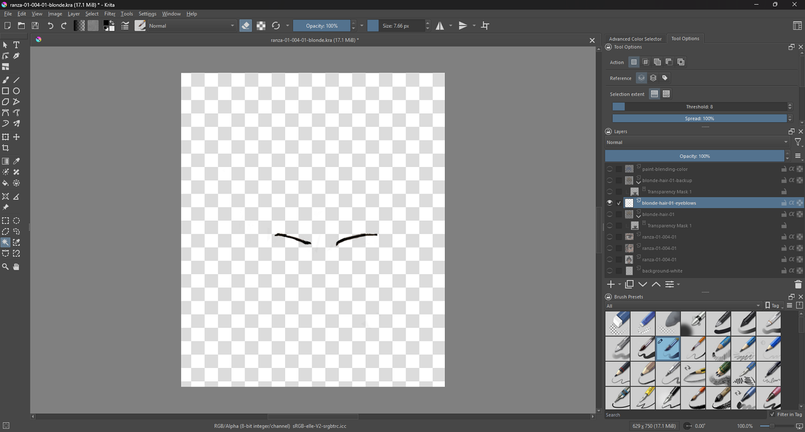

## Step 6: Check Small Areas Under the Bangs

With a white background behind the hair, it's easier to see what's left. Select any small leftover areas under the bangs with the same selection tool and delete them.

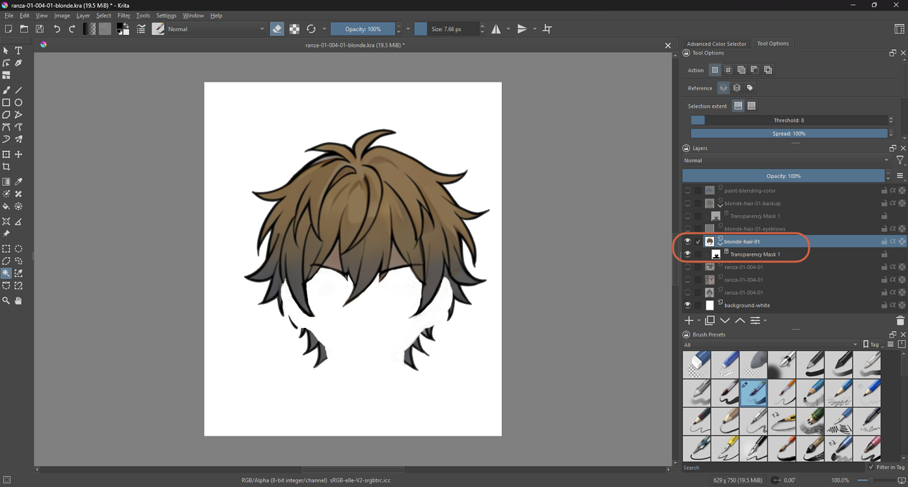

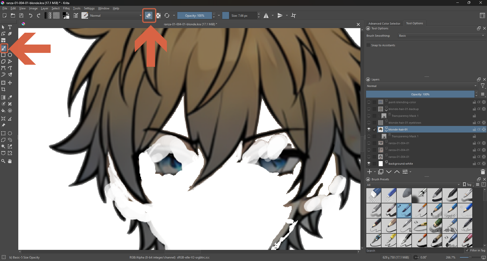

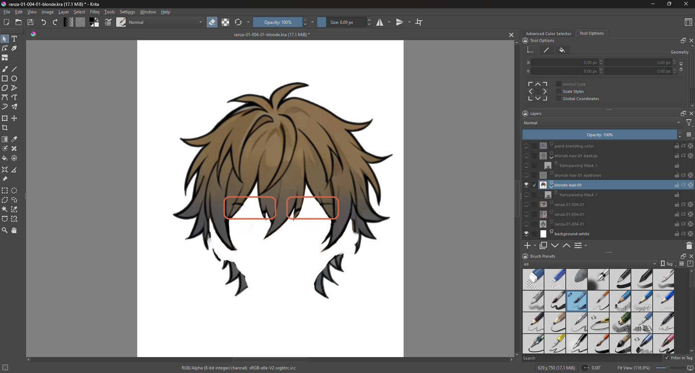

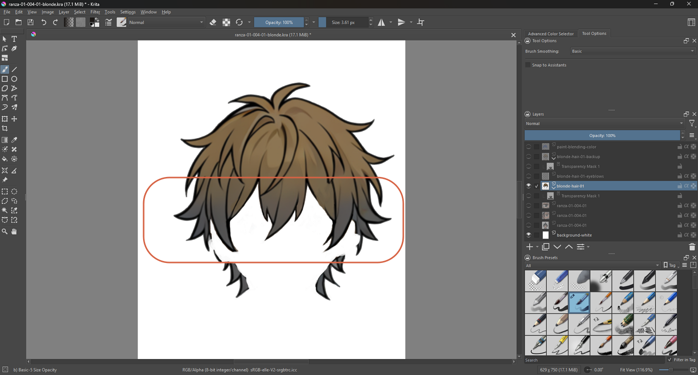

> **Warning:** Some pale patches can still remain near the lower hair even after this pass. See [Closing the Hair Line with a Curve](close-hair-line-with-curve.md) for one way to close a gap in the outline rather than just erasing around it.

## References

- [Krita Manual: Contiguous Selection Tool](https://docs.krita.org/en/reference_manual/tools/contiguous_select.html)
- [Krita Manual: Similar Color Selection Tool](https://docs.krita.org/en/reference_manual/tools/similar_select.html)
- [Krita Manual: Edit Menu](https://docs.krita.org/en/reference_manual/main_menu/edit_menu.html) — Clear and Deselect.
